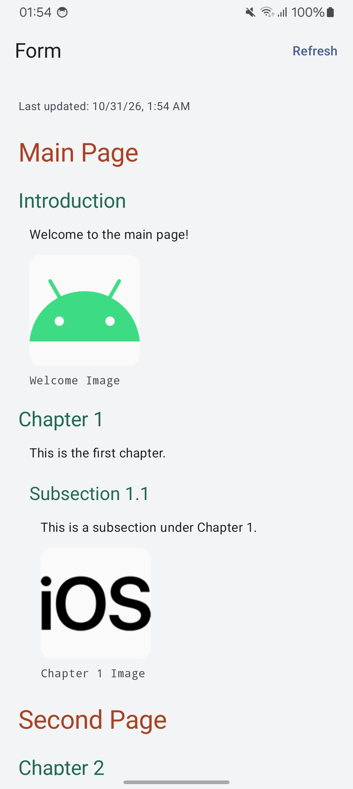
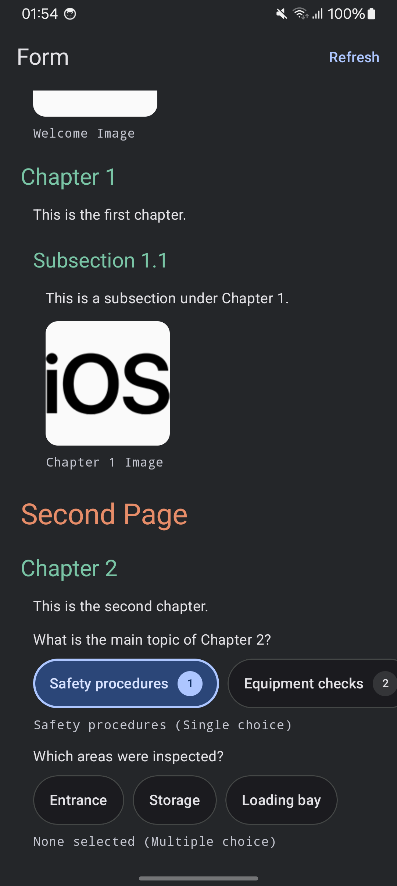
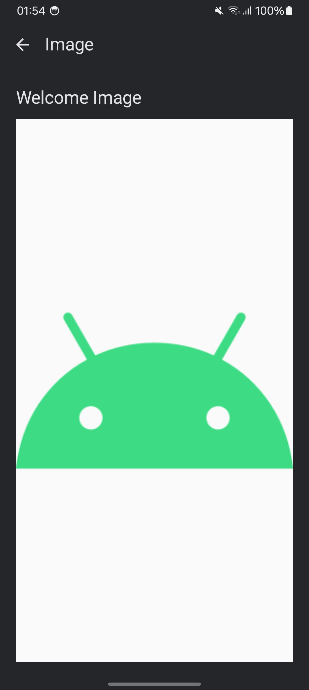
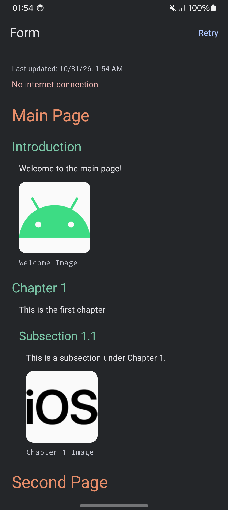

# Lumiform Android Challenge

My implementation of the Lumiform Android coding challenge.

The current test baseline has **132 JVM tests** and **63 device tests**, all passing.
Focused JVM logic coverage is **98.1% of lines** and **91.3% of branches**, with an
**80% line-coverage gate**. See [Coverage](#coverage) for the measured scope,
exclusions, device results, and commands to reproduce the reports.

## Status

The foundation includes feature modules, my custom MVI base, Hilt, and Navigation 3.
The form feature has domain models, JSON validation, API fetching, and relational
offline storage. The screen observes saved content, refreshes on first open, and
renders pages, nested sections, text, choice controls, and image thumbnails. Single
and multiple answers are saved locally and preserved when refreshed definitions
still support them. Loading, empty, error/retry, refresh progress, and last-update
states are implemented. Images open in a titled viewer and downloaded originals
remain available offline.

## Screenshots

Captured from the app on Samsung A23, Android 14. The phone supplies the dynamic
Material colors; other devices can use a different accent palette.

| Form hierarchy · light | Choices · dark |
| --- | --- |
|  |  |

| Image viewer · dark | Saved form · offline |
| --- | --- |
|  |  |

## Startup

`SplashActivity` is the launcher and uses AndroidX SplashScreen. It opens
`MainActivity` and finishes, so Back does not return to the splash. I keep the
system splash during this handoff instead of drawing a second splash layout.
There is no fixed delay or network request in the launcher.

This follows Android's [routing Activity pattern](https://developer.android.com/develop/ui/views/launch/splash-screen/migrate).
The custom-splash lint check is disabled only on this Activity because it never
draws its own splash content.

## Light and dark themes

The app follows the device's light/dark setting. Compose uses Material 3 dynamic
colors on Android 12+, with light/dark fallback palettes on older versions.
The native window and splash also have matching night resources and system-bar
icon settings; both Activities use AndroidX edge-to-edge handling.
Both screens and their top bars use a neutral gray surface in light and dark mode;
the native window and splash share the same background.
Dynamic palettes are remembered with configuration keys, so night mode and
resource-color changes refresh them. The light image canvas keeps transparent
black artwork readable in either mode.

Page titles use coral and section headings use green, inspired by the challenge's
example. Shared day/night resources keep these hierarchy colors readable in both
themes, including when the device supplies dynamic Material colors. Question text
keeps the theme's neutral foreground; size and indentation also show the hierarchy.

## Structure

- `app`: application, splash launcher, MainActivity, root navigation, and app identity strings.
- `base`: MVI contracts and `BaseCoroutineViewModel`.
- `design`: shared Compose theme and reusable UI components, including choice chips.
- `networking`: shared OkHttp client, logging interceptor, and Retrofit instance.
- `resources`: shared Android resource files, including UI strings, icons, XML themes,
  and backup configuration.
- `feature/form` (`:form`): form and image destinations, UI, ViewModels, and the
  feature's data and domain layers.

I keep the layers inside each feature, so changes to the form stay together.
Feature modules live next to each other under `feature/`.
There are no separate data or domain Gradle modules.

Presentation code is grouped by screen:

```text
presentation/
  screens/
    form/       screen, route, components, mapper, model, preview, viewmodel
    image/      screen, route, mapper, model, viewmodel
  components/   shared image rendering and loader
  navigation/   destinations and shared transitions
```

Shared Android `res/` files live in `resources/src/main/res`. Modules that use them
depend directly on `:resources` and import `com.lumiformtest.resources.R`.
I keep Compose theme code and reusable UI components in `:design`, as in ASA.
Shared Compose sizes and spacing live in `design/theme/Dimensions.kt`, including
the thumbnail size used by the form, previews, and image sizing tests.
Shared components accept display values and callbacks; feature models and answer
handling stay in `:form`.

App identity strings, such as `app_name`, live separately in
`app/src/main/res/values/strings_non_translatable.xml` and use `translatable="false"`.

## Layer mapping

I use separate models and explicit mappers at each layer boundary:

```text
DTOs / Room entities -> domain models -> UI models
       data/mapper              screens/<screen>/mapper
```

Data mappers handle storage and API formats. Presentation mappers prepare domain
data for the screen, including hierarchy depth and display state. This keeps
DTOs, entities, and domain models out of screen state and composables.

Mappers stay inside the feature and have no side effects. DTO/domain,
entity/domain, and domain/UI mappers are implemented. The presentation mapper
flattens the tree in source order and preserves parent IDs, depth, and question
metadata. Reverse mappings are added for actual write operations.

## Content contract

The parser handles pages, sections, text, images, and choices using the endpoint's
`type` field. Domain models use Kotlin types without serialization annotations or
Android dependencies. The mapper preserves source order, text, IDs, image titles
and URLs, choice settings, and optional nullable integer scores.

I validate the complete snapshot before it can replace saved content. Content IDs
are unique across the document. Response-set IDs have a separate namespace, and
option IDs are unique within each set. Questions can share a response set when
its ordered definition matches; conflicting definitions are rejected.

Extra metadata fields are accepted. Unknown content types, missing required
fields, invalid hierarchy, and duplicate IDs produce `InvalidFormContentException`
in the data layer. The repository handles this failure while keeping the last
valid content. Empty documents, pages, and sections are supported.

## API and offline storage

The `:networking` module provides singleton OkHttp and Retrofit instances through
Hilt, following ASA. It owns the base URL, bounded connection/read/write/call
timeouts, and the [HTTP logging interceptor](https://github.com/lysine-dev/okhttp/tree/main/okhttp-logging-interceptor).
Debug logs form bodies and image headers; release clients have no logging interceptor.
The feature declares `FormApi` and creates it from the injected Retrofit instance.
Form decoding, validation, and failure handling stay in `:form`.

Retrofit fetches the challenge endpoint with OkHttp. The response body is closed
after the existing parser decodes and validates it. Fetching, body reading, and
mapping run outside the main thread.

I use Room as the source of truth. The repository observes only saved snapshots;
fetching alone does not publish content. Five tables store nodes with parent IDs
and sibling positions, response sets, ordered response options, selected answers,
and the last successful refresh time. This is structured storage rather than a cached JSON blob.

Room reads and replaces each snapshot in a transaction. A write failure rolls
back both content and metadata. A failed fetch or invalid response never starts
replacement. An empty fetched form has metadata; no saved form is represented
by null. Cached read errors propagate rather than pretending the cache is empty.

A mutex covers the complete fetch-and-save operation, so overlapping refreshes
cannot commit out of order. Cancellation propagates, and expected fetch, content,
and storage failures are exposed as domain results. ObserveFormUseCase and
RefreshFormUseCase provide the boundary for the MVI integration. Expected saved
content read failures become a domain observation result; retry restarts a failed
observer. The ViewModel does not import Room or data-layer exceptions.

Schemas 1 and 2 are exported under `feature/form/schemas` and kept in Git. The explicit
1 -> 2 migration adds selections and their indexes without clearing the saved
form. There is no destructive-migration fallback. Image URLs stay in Room;
downloaded originals live in app-owned files.

## Choice persistence

Single-choice questions replace their previous answer and keep an already-selected
option selected. Multiple-choice options toggle independently. The DAO reads the current
saved definition and applies each operation in one transaction. Answers belong
to a question and response set; shared definitions do not share selected answers.
Composite foreign keys reject options from a different set. A stale or removed
option returns a domain failure; saved answers stay unchanged.

Refresh reads the latest selections inside its write transaction, then restores
only valid answers after replacing definitions. This includes answers saved while
the request was still fetching. A changed question type or response-set identity
clears invalid answers; removed options are discarded. When multiple choice becomes
single choice, the first surviving selected option in the new display order is
kept. Any failed replacement rolls back content, answers, and refresh time together.
Selection writes never change the successful remote refresh timestamp.

Choices remain usable during network refresh or a failed request. They are disabled
while a saved-content read failure prevents reliable observation. Selected state
comes from Room, with no optimistic update. Write failures stay in screen state and show a
message while the screen is resumed; retry is another explicit tap, not an automatic
replay of a toggle.

Options use custom rounded chips from `:design` in a single horizontally scrolling
row. Its viewport reaches both screen edges, while content padding keeps the first
and last options aligned with the form. Labels stay on one line, and each response
set retains its scroll position. Selected chips
have a different fill and border, while radio/checkbox semantics keep the behavior clear
for accessibility. Optional response scores appear as badges; no score is calculated.
The footer lists saved selected labels, or "None selected", beside the choice type.
Lists and score values follow the current locale.
Multiline option labels display on one line without dropping words. Blank labels
use numbered names in the chips and selection summary; saved definitions stay
unchanged. Questions with an empty response set show "No options available".

## MVI

The UI sends an `Action` to the ViewModel. I handle state changes and side effects
in the same `onAction` function. For this small feature, it keeps the flow easy
to follow without separate reducer and effect-handler classes.

Actions are queued in order. Work launched by an action can finish later, so it
must edit the latest state rather than write an old state snapshot. The initial
state is passed to the base constructor to avoid calling an overridden method
before the feature ViewModel is initialized.

`StateFlow` holds the screen state. Navigation and temporary UI events use separate
channels with one consumer each. They can wait for a collector while the ViewModel
is alive, but are not durable storage or an exactly-once delivery mechanism.
The action queue is unlimited, following my ASA implementation, and is intended
for discrete UI actions rather than continuous input streams.

I prefer lazy initialization where creation can safely wait until first use,
following ASA. The MVI state/channels, parser configuration, refresh mutex, fallback
theme palettes, selection queue/writer, and preview data use lazy properties. Conditional injected
dependencies use Dagger Lazy; release builds do not create the unused logger.
Compose values keep their lifecycle-aware remember behavior, and cleanup does not
initialize unused resources.

The form ViewModel observes Room and starts one refresh per ViewModel instance.
Repeated refresh taps are coalesced while work is active. Choice taps use one
FIFO writer so suspended writes cannot reorder accepted input. Cache reads and refresh
have separate state: a fast fetch failure cannot hide a pending cache read, and
refresh success waits for Room rather than publishing response content directly.
Saved content and its timestamp remain visible on refresh failure. After a transport
failure, the data source checks the network status supplied by `:networking`.
When Android reports no validated internet connection, the screen shows "No internet
connection". Other request failures keep the existing message. This check does not
block successful requests or turn cancellation into an offline error. Network-state
capabilities follow the [Android connectivity guidance](https://developer.android.com/develop/connectivity/network-ops/reading-network-state).
The list uses stable IDs and saved scroll
state. Section headings decrease through 22, 20, 18, and 16 sp, then keep the
16 sp minimum above 14 sp question text. The policy lives in
`design/theme/HierarchyTypography.kt`; indentation also has a readable limit.
Image captions use the same small monospace style as choice-selection summaries.
Pure presentation mapping reuses flattened rows when only selections change, replacing
only affected choice rows.

The list uses validated unique node IDs as keys and separate content types for
row reuse. The same callbacks are shared across rows, and item content captures
only the values it needs. Choice options have keys qualified by response-set and
option IDs, keeping focus with the option after a definition reorder. Each
option is a separate skippable composable. Scroll position is read by the lazy
layout rather than by the screen composition. These choices follow Android's
[Compose performance guidance](https://developer.android.com/develop/ui/compose/performance/bestpractices).

The UI applies navigation commands to a saved Navigation 3 back stack. Serializable
keys hold only navigation arguments, and each entry owns its ViewModel and saved
Compose state. Tapping a thumbnail sends its ID through the form's navigation
output. The image entry resolves current title and URL from saved content through
ObserveImageUseCase and its own MVI ViewModel, then maps metadata to a UI model.
A removed image has a missing state; a failed saved-content read has retry.

## Images

I use [Coil 3.6.3](https://coil-kt.github.io/coil/changelog/) for image decoding,
size-aware rendering, and a bounded memory cache. The Application supplies one
Hilt-backed ImageLoader through Coil's lazy singleton factory. Its first creation
runs on IO, with a fixed-size placeholder while preparing, so dependency setup
does not block the UI thread. Preparation is shared by the form entry, so rows
returning to the viewport get the prepared loader immediately. Thumbnails fit the
whole image inside a compact 120 dp square. AsyncImage resolves the decode target
from measured layout bounds and device density, without enlarging small originals.
Coil can reuse a suitable nearby decode size. Separate thumbnail/viewer memory
keys keep a large viewer bitmap out of the scrolling list. The viewer fits the
whole image and keeps its title visible.
A shared light canvas keeps transparent black artwork readable in dark mode.
Loading and retry states belong to the image component; they do not block form
content or reset answers.

The image expands from its thumbnail into the viewer with a 350 ms shared-element
transition, and shrinks back on Back. The shared key uses the node ID, so separate
questions using the same URL do not animate into each other. Navigation still
carries only the image ID. The same image layout stays in place while its bounds
and corner shape animate together. A loaded bitmap stays visible during motion;
the larger original is decoded afterward, with the thumbnail covering the handoff.
Back uses the cached viewer bitmap when available.
The shared overlay is clipped to the screen's content viewport, so a partly hidden
thumbnail stays behind the app bar during opening and closing.

A temporary UI preview carries the clicked image metadata and prepared loader
into the viewer, so reading Room does not insert a loading screen into the motion.
Saved observations remain authoritative, including missing images and read errors.
The preview is not saved in navigation state; restored entries resolve from Room.
Standalone screens and previews also work without a transition scope.

Coil's HTTP fetcher is replaced with a small retained-file fetcher. The feature's
ImageApi uses the shared Retrofit/OkHttp instance from :networking. Image requests send Accept: image/* so debug logging records only headers and
keeps the response body streamed. The fetcher
saves the original bytes before Coil displays them, so a thumbnail does not become
the only available offline resolution. Originals also serve as the disk layer;
Coil's separate evictable disk cache is disabled to avoid storing another copy.
The extension follows Coil's [fetcher API](https://github.com/coil-kt/coil/blob/3.6.3/coil-core/src/commonMain/kotlin/coil3/fetch/Fetcher.kt).
Image bytes stay inside this rendering/storage pipeline; domain and UI mapping
still handle image metadata, without exposing platform files or bitmaps.

Each full URL, including its query, has a SHA-256 filename. Requests for the same
URL share a mutex. Downloads stream on IO, are limited to 20 MiB, and must pass a
small raster decode before an atomic rename publishes the original. Failure or
cancellation removes the temporary file. Existing valid files need no network;
corrupt files can be downloaded again. Per-process file stamps (length and modified
time) avoid repeating the validation decode while a retained file is unchanged.
No database migration is needed here.

For this small form, downloaded originals are retained until app data is cleared,
including images removed from later definitions. URLs identify immutable images;
changed bytes at the same URL are not automatically refreshed. There is no image
prefetch or background download: an image must have finished loading once before
it is available offline. Zoom and export are outside the challenge scope.

## Setup

```shell
git clone https://github.com/karen-1996/LumiformTestApp.git
cd LumiformTestApp
```

- Use Android Studio with support for Android Gradle Plugin 9.5.
- Use JDK 25 for Gradle, as configured in `gradle/gradle-daemon-jvm.properties`.
- Install Android SDK 37. The minimum supported Android version is 8.0 (API 26).
- Open the project and let Gradle sync. Set the Android SDK location in Android
  Studio or in an untracked `local.properties` file using `sdk.dir`.

## Build

App versions are set in root `version.properties` (`versionCode` and `versionName`).
Shared SDK versions are set in `gradle.properties` (`android.minSdk`,
`android.compileSdk`, and `android.targetSdk`). The root build script applies them
to all Android modules, following ASA; targetSdk applies to the app.

```shell
./gradlew :app:assembleDebug :app:lintDebug
```

Release enables code and resource shrinking; debug explicitly disables both.
Routine verification uses debug builds; release checks are run only when requested.

Base URLs are configured in `gradle.properties` as `networking.baseUrl.debug` and
`networking.baseUrl.release`. Both use the challenge host by default. The networking
module generates `BuildConfig.BASE_URL` for the selected build type, which Retrofit
reads at runtime. URLs must include a trailing `/`. To override a URL for one build:

```shell
./gradlew :app:assembleDebug -Pnetworking.baseUrl.debug=https://example.com/
```

On Windows, use `gradlew.bat`. Run the `app` configuration on an emulator or device
with API 26 or newer.

## Tests

```shell
./gradlew :base:testDebugUnitTest :networking:testDebugUnitTest :form:testDebugUnitTest
```

The JVM tests cover MVI behavior, destination keys, parsing, entity/domain mapping,
HTTP responses, cache-preserving failures, cancellation, overlapping refreshes,
domain/UI hierarchy and selection mapping, refresh reconciliation, and MVI
cache/refresh timing, ordered writes, cancellation, and error recovery. Image tests
cover original-file reuse, serialized downloads, failures, size limits, cancellation,
corruption recovery, URL identity, and viewer metadata changes/removal.
Networking tests also check the shared transport and logging policy. The optional
:networking:testReleaseUnitTest task checks the release policy separately.
HTTP tests use MockWebServer and do not depend on the public endpoint. The fixture in
`feature/form/src/test/resources/fixtures/lumiform-android-test.json` is a snapshot of the
[challenge endpoint](https://gist.githubusercontent.com/aruana-lumiform/383e1291df3e0cc1d49aeb14d45f5b94/raw/lumiform-android-test.json).
The sample and the [local edge-case scenarios](feature/form/src/test/resources/fixtures/scenarios/README.md)
are test input only. JVM tests read them as resources, and device tests read the
same files from test APK assets. They are not packaged in the production app.

The final source was also checked in a fresh local directory without IDE state
or project build output. Debug app/test builds, all 132 JVM tests, and lint passed
using the installed Android SDK and an existing Gradle dependency cache.

Check connected devices first, unlock the selected device, and target its serial:

```shell
adb devices -l
ANDROID_SERIAL=<serial> ./gradlew :app:connectedDebugAndroidTest :form:connectedDebugAndroidTest
```

The navigation device test checks that the image destination survives saved
Compose state restoration and that Back returns to the form. It uses an empty
Hilt Activity available only in debug builds. This is not a full process-death
navigation test.

The startup device test launches the app through its launcher intent and checks
that MainActivity becomes the task root after the splash handoff. Theme tests
resolve native window/splash colors and bar icons in both configurations, then
switch Compose between system modes with fallback and dynamic palettes. They
check readable text contrast and matching fallback window/background colors.

Stateless form screen tests cover row kinds/headings, retry actions, cached content
during refresh/failure, empty versus loading, saved list position, and long nested
text at a large font scale in both themes on a small layout width. A typography
check reads the rendered text styles at normal and 2x font scale, verifying that
section sizes decrease over four levels and clamp above question text. Choice tests
check radio/checkbox semantics, one action per chip tap, saved-selection summaries,
horizontally scrolling chips, score badges, touch targets, failure messages, disabled controls, and long
labels with large fonts. Image UI tests cover
thumbnail navigation, missing/read-error states, failure-to-success retry, actual
thumbnail bitmap bounds/cache separation, and non-blocking first loader creation.
Clock-controlled checks verify expansion/shrink bounds, intermediate corner shapes,
and return to the thumbnail's position. A real Coil test delays saved metadata and
the original image, checking that the loaded thumbnail stays visible through the
animation and decoder handoff, while saved read errors still take priority.
Another pixel check scrolls a thumbnail partly under the app bar and verifies
that image pixels stay out of the bar throughout both navigation directions.
List tests check anchor retention when rows above it are inserted/removed and
focus/selection identity when response options reorder.
A real Coil pipeline test loads a thumbnail, closes its loader, and uses a new
loader with no network to decode the larger retained original. Invalid image
bytes are rejected before publishing a file.

The form device tests use a real Room database to check reopen persistence,
offline refresh failure, foreign-key rollback, empty-cache semantics, and complete
observed snapshots. Selection tests cover foreign keys, shared definitions,
concurrent taps, mode/identity changes, rollback, answers saved during fetch, and
coherent observed definitions/answers. A migration test starts from the exported
v1 schema, preserves its content/time, and saves/reopens answers in v2. These
tests create and remove separate test databases.

The real app was also checked manually after a successful fetch: with the test
emulator's network disabled and no active network, a force-stop/relaunch displayed
saved content and selected answers, retained the successful update time, and
offered retry after refresh failed. Another checkbox answer was saved offline.
After reconnecting, a successful refresh retained all answers and updated the
refresh time. Both image originals were also downloaded in the real app. With no
active network, a force-stop/relaunch loaded thumbnails and opened the titled
viewer. Back restored the exact scrolled form position. The open viewer also
returned from Recents after the background app process was killed, while still
offline. These are manual emulator checks, separate from saved-state UI tests.

On Samsung A23 (Android 14), an offline cold start also kept the saved form and
titled image viewer available. The screenshots above show the final typography,
light/dark modes, choices, and cached-content fallback on that device.

## Coverage

Coverage uses [AGP's built-in JaCoCo support](https://developer.android.com/studio/test/coverage-report),
with the version pinned in the version catalog. It is opt-in with `-Pcoverage=true`
and applies only to debug. Normal debug APKs have no coverage instrumentation.

Baseline measured locally on **2026-10-31**:

| Measurement | Result |
| --- | --- |
| JVM logic line coverage | **98.1%** — 689/702 lines |
| JVM logic branch coverage | **91.3%** — 263/288 branches |
| JVM tests | **132 passed** |
| Device tests | **63 passed** |
| Device-only line coverage, `:app` | **74.9%** |
| Device-only line coverage, `:form` | **72.8%** |

The JVM percentages describe the non-UI logic scope below. UI rendering and
Android integration have separate device tests. These are recorded results,
not a live CI badge; regenerate the reports after code changes.

Run the JVM suites, generate reports, and enforce the 80% line-coverage minimum:

```shell
./gradlew debugUnitTestCoverage -Pcoverage=true
```

The focused aggregate report is at `build/reports/coverage/jvm/html/index.html`,
with XML at `build/reports/coverage/jvm/report.xml`. It merges JVM execution data
from `:base`, `:networking`, and `:form`, using AGP's public class artifacts.
`debugJvmCoverageCheck` enforces at least 80% **line** coverage across this scope;
branch coverage is reported separately. To generate the focused report without
the gate, run `debugJvmCoverageReport -Pcoverage=true`.
Missing execution data or an empty coverage scope also fails the gate.

The scope keeps handwritten JVM logic: MVI/ViewModels and contracts, domain
models/use cases, DTO parsing/validation, repositories, mappers, response
reconciliation, image-file caching/fetching, and the HTTP logging interceptor.
Uncovered code in those areas stays in the denominator. ViewModels, contracts,
models, and mappers remain included under `screens/form` and `screens/image`;
only rendering code is excluded there.

Excluded from this focused JVM metric:

- Compose screens, routes, components, previews, and image/navigation transitions.
  Serializable destination keys remain included.
- Android adapters that use Room/SQLite or BitmapFactory: DAOs, database setup,
  migrations, the Room local data source, and bitmap validation. These have device
  tests; the JVM metric makes no claim about their coverage.
- DI wiring and generated Hilt/Dagger, Room implementations, resources, and BuildConfig.

`:app` currently contains Android startup/navigation wiring, and `:design`
contains Compose components/theme code, so neither belongs to this JVM logic
scope. The exclusions are explicit in `build.gradle.kts`. Add new JVM logic/modules
to the scope when the architecture grows.

The original full-module reports remain available:

| Module | HTML report |
| --- | --- |
| base | `base/build/reports/coverage/test/debug/index.html` |
| networking | `networking/build/reports/coverage/test/debug/index.html` |
| form | `feature/form/build/reports/coverage/test/debug/index.html` |

Device coverage runs the existing `:app` and `:form` instrumentation suites.
Check connected devices first, unlock the selected device, and use its serial:

```shell
adb devices -l
ANDROID_SERIAL=<serial> ./gradlew debugAndroidTestCoverage -Pcoverage=true
```

Reports are written under each tested module's
`build/reports/coverage/androidTest/debug/connected/index.html`.
For a single module, use `:form:createDebugUnitTestCoverageReport` or
`:form:createDebugAndroidTestCoverageReport`, with the same coverage property.

Unit and device reports measure different executions. Do not add or average their
percentages. Full-module reports include UI and generated code, so their JVM
number alone does not describe Room or Compose coverage. Use the focused aggregate
for the 80% JVM gate and keep the full/device reports for their separate scopes.
Coverage does not prove visual correctness or scrolling performance.

Reports and execution data stay under ignored `build/` folders.

## Compose previews

Each screen and visual component has named, themed previews beside its code.
They cover content, loading/failure, selected/disabled choices, dark mode, and
long text where relevant. Screen previews use sample UI models instead of Hilt
routes. Shared fixtures live in
[FormPreviewData.kt](feature/form/src/main/java/com/lumiformtest/form/presentation/screens/form/preview/FormPreviewData.kt).
Image previews use a local drawable and never create the image loader or make
network/database calls. Preview wrappers and non-visual state helpers are covered
through their screen/component previews.

## AI development guidance

[aidev](aidev/README.md) contains the project skills and how they are used.
`AGENTS.md` routes relevant work to them. The skills record my architecture and
review choices; they do not replace code review or tests.
